<div align="center">

<a href="https://nafeesium.github.io/Nafeesium/">
  
</a>

</div>



## ▸ ABOUT

I'm Nafeesium, an independent developer working across game systems and small web tools. Right now that mostly means GDScript (Godot's own language) and whatever game idea survives long enough to get a project folder.
No studio, no roadmap review, just me and a folder structure that made sense at 2am.


## ▸ QUEST LOG

| Status | Project | Details |
|:---:|---|-----------|
| `PROTOTYPING`|  **BLIGHT** | An FPS survival shooter taking place in liminal place. |

<!-- ordering above is roughly by how much time each one has eaten -->


## ▸ TECH

<div align="center">


</div>


## ▸ STATS
<!-- streak stats is probably gonna look sad ngl -->
<div align="center">


</div>


## ▸ REACH ME

|  |  |
|---|---|
| Email | `nafeesium@gmail.com` |
| GitHub | `github.com/Nafeesium` |
| Instagram | `instagram.com/nafeesium` |

<div align="center">

```
TO BE CONTINUED...
```

</div>
